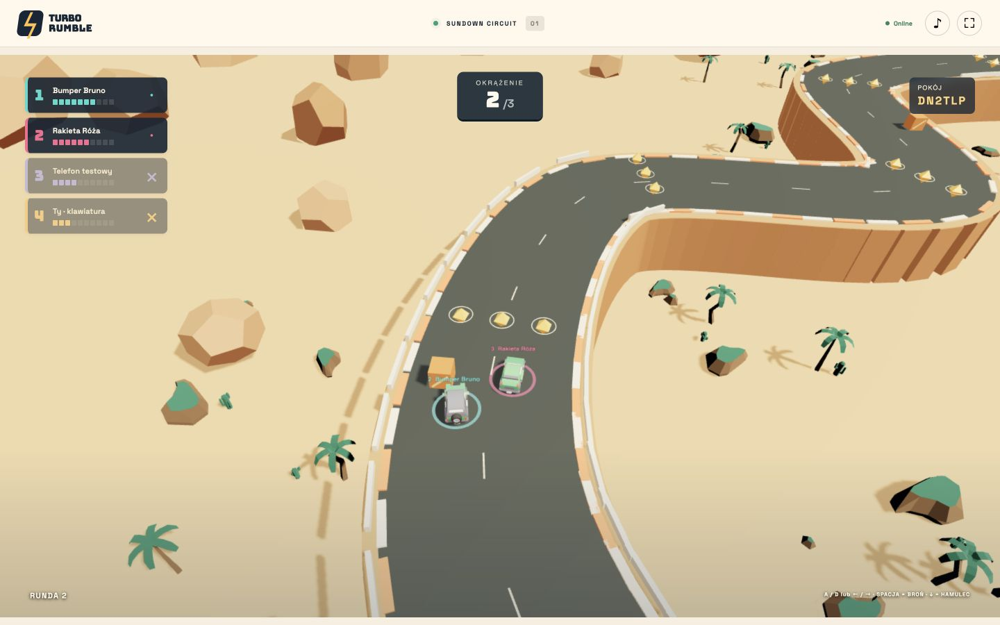

# Turbo Rumble

Browser-based party racing for **2–8 players**. Share one screen on a computer or TV and use your phones as controllers. Three maps, drifting, rockets, mines, nitro and a podium at the end of every match. Keyboard controls and bots are also supported. Available in English and Polish.

**[Play now → turborumble.rastwork.pl](https://turborumble.rastwork.pl/)**



Create a room on the shared screen, then scan its QR code or enter the room code on each phone. The hosted game works across different networks. Use **Share room** to send an invitation with **Watch live race** and **Join as controller** options plus a phone QR code. Lobby QR codes open the controller directly (returning players reconnect; new players enter a nickname). Spectators watch without taking a player slot or gaining host controls.

## Run locally

Requirements: **Node.js 24.15 or newer** and npm.

```sh
npm ci
npm run dev
```

Open **http://localhost:4317**, create a room and scan the QR code with your phone. For local play, connect the computer and phones to the same Wi-Fi network. Phones use the host's LAN address, not `localhost`.

## How to play

- Acceleration is automatic. Steer left or right; press both directions to brake, then keep holding once stopped to reverse. Release to drive forward again.
- Hold a turn to drift. Collect and use items, stay on the track and keep up with the shared camera.
- Keyboard: **A/D** or **←/→** to steer, **Space** to use an item, **↓** to brake and hold at a stop to reverse.
- When two racers remain, time limits are lifted: finish all laps to earn +2 points for first place and +1 for second. Eliminating a rival still ends the round as usual.
- The host or first player chooses the map and rules. The countdown starts when everyone is ready.

## Development and hosting

**TypeScript · Three.js · Rapier · Socket.IO · SQLite**

```sh
npm run check                 # types, lint, formatting and tests
npm run build && npm start    # production build and server
```

[Architecture](docs/ARCHITEKTURA.md) · [Docker / Coolify](docs/COOLIFY.md). Run a single server replica; restarting ends active rooms. Completed results are stored in `DATA_DIR/results.sqlite`. The detailed technical docs are currently in Polish.

## Versioned commits and releases

For a commit **and push**, stage only the reviewed files, then run:

```sh
npm run release -- "feat: describe the change"
```

This local command checks the project, records the Conventional Commit, updates the package/lock versions and [changelog](CHANGELOG.md), rebuilds, and pushes a release commit with its `vX.Y.Z` tag. `feat` means minor, breaking changes mean major, and other Conventional Commit types mean patch. The first semantic release is 1.0.0. No release runs in CI or during deployment. Requirements and recovery: [Local releases](docs/RELEASING.md). The menu footer and health endpoint expose the package version.

## License and credits

Original code and documentation: **[PolyForm Noncommercial 1.0.0](LICENSE)**. Free to use, modify and share for noncommercial purposes under the license terms. The license does not grant permission to commercialize the game's code. Keep [NOTICE](NOTICE) when redistributing. This is a source-available project with a commercial-use restriction.

Third-party assets and libraries retain their own licenses; the project's noncommercial restriction does not replace them. Kenney models: **CC0**. Tire-skid recording: **CC BY 3.0**, with attribution required; see the [audio sources](public/assets/audio/SOURCE.md). Cinematic menu backgrounds are AI-generated illustrations, not gameplay screenshots; see their [provenance](public/assets/cinematics/SOURCE.md). Further credits and licenses are available [in the game](https://turborumble.rastwork.pl/credits) and in `public/assets/`.

**Created by:** Benjamin Rast · [GitHub](https://github.com/dziksu) · [rastwork.pl](https://rastwork.pl/)
