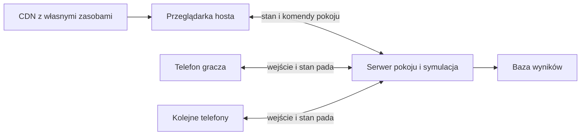
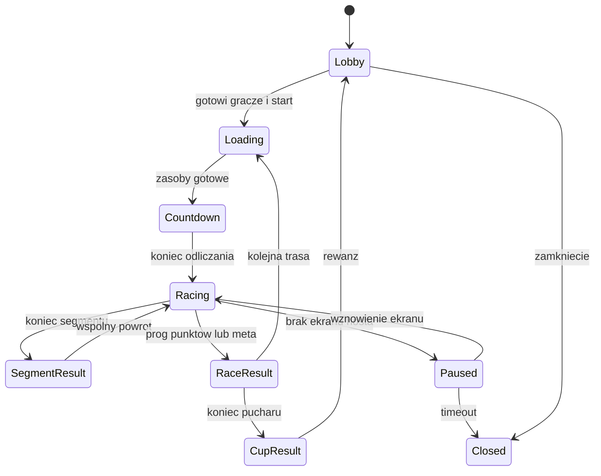

# Racing Wars analiza techniczna i specyfikacja gry przeglądarkowej

Analiza z 21 października 2026 r. Cel: zbudowanie własnej gry wyścigowej dla 2–8 osób, ze wspólnym ekranem hosta oraz telefonami jako padami, z pokojami „Nowa gra” i „Dołącz”.

Najważniejszy wniosek: podobieństwo zależy od automatycznego napędu, łatwego sterowania poprzecznego, kolizji, wspólnej kamery wymuszającej tempo i krótkich cykli eliminacji. Sama strona do wpisywania kodu jest prostą częścią projektu.

Zakres obejmuje obserwację publicznego buildu twórców na Newgrounds, test dwóch graczy z klawiatury, analizę jego publicznych plików Unity oraz materiały wydawcy. To rekonstrukcja funkcjonalna i projekt implementacyjny. Nie odzyskano pełnych źródeł C# ani kompletu oryginalnych współczynników. Historyczny build z 2016 r. nie jest dowodem identycznego zachowania obecnej wersji AirConsole.

# Poziomy potwierdzenia

| Oznaczenie | Znaczenie |
| --- | --- |
| Potwierdzone w grze | Ekran lub zachowanie publicznego buildu faktycznie zaobserwowane podczas testu |
| Potwierdzone w danych | Odczyt standardowych struktur lub identyfikatorów publicznego pakietu Unity |
| Opis wydawcy lub twórców | Deklaracja na oficjalnej stronie albo w oficjalnym nagraniu |
| Wniosek | Wyjaśnienie zgodne z obserwacjami, wymagające osobnego testu |
| Projekt nowej gry | Konkretna decyzja implementacyjna, nie parametr odzyskany z oryginału |

Aktualna karta AirConsole podaje 1–8 graczy. Strona twórców na Newgrounds opisuje historyczną wersję dla maksymalnie pięciu graczy na klawiaturze. W tej analizie uruchomiono dwóch lokalnych graczy. Nie wykonano testu ośmiu fizycznych telefonów. [AirConsole](https://www.airconsole.com/play/battle-games/racing-wars), [wersja twórców](https://www.newgrounds.com/portal/view/684836).

# Potwierdzone mechaniki Racing Wars

Gra przedstawia małe kolorowe samochody w przestrzeni 3D. Wszyscy patrzą na jeden ruchomy kadr. Odpadnięcie wskutek pozostania z tyłu, wypadnięcia z trasy albo ataku przeciwnika należy do podstawowych zasad. Wyścig kończy próg 10 punktów lub ukończenie trzech okrążeń, po którym liczy się wynik punktowy. Oficjalny opis podaje początkowe 5 punktów. [Opis zasad wydawcy](https://www.airconsole.com/games/racing-wars-is-finally-here).

W teście klawiaturowym akcja gracza oznaczała dołączenie/gotowość w lobby. Po gotowości dwóch osób pojawiło się odliczanie od 5. Auta ruszyły bez przycisku gazu. Gracz bez dalszych komend pokonywał zakręty; dłuższe przytrzymanie lewego kierunku spychało sterowane auto ku lewej stronie i poza drogę. Wniosek: bazowy model jest wspomagany przebiegiem trasy. Nie ma podstaw do traktowania go jako swobodnego symulatora kierownicy.

Na ekranie wyścigu widać kolor, nazwę, miejsce oraz pasek punktów gracza, a u góry wspólny licznik okrążeń. Po upadku auta zaobserwowano jego późniejszy powrót do wspólnej jazdy; eliminacja nie musi oznaczać czekania do końca całego pucharu.

Ekran „Race Results” po trzech okrążeniach pokazał zwycięzcę z wynikiem klasyfikacji 1 (+1), drugiego gracza z 0, podgląd następnej trasy i „Press Continue”. To bezpośredni dowód odrębnej klasyfikacji między wyścigami. [Publiczny build poddany testowi](https://uploads.ungrounded.net/alternate/1038000/1038098_alternate_39815_r1.zip/).

# Puchary i trasy

W menu publicznego buildu potwierdzono następujące zestawy:

| Puchar | Kolejność tras zaobserwowana w menu |
| --- | --- |
| Fast Cup | Downtown, Water Hill, Farm Jump |
| War Cup | Water Hill, Downtown, Death Mountain |
| Super Cup | Death Mountain, Farm Jump, Downtown |

W pakiecie znajdują się dokładnie cztery sceny torów: Death Mountain, Downtown, Farm Jump i Water Hill. Oprócz nich są sceny inicjalizacji, lobby, menu i wyników. To cztery różne tory, które mogą być ponownie wykorzystywane w różnych pucharach, a nie dziewięć potwierdzonych torów.

Fast Cup kładzie nacisk na tempo, War Cup na częstsze przedmioty i walkę, a Super Cup na połączenie obu. Oficjalne teksty są niespójne: karta gry używa też nazw Rock Cup i Vacation Cup, natomiast artykuł oraz działające menu wskazują inne nazwy. Nie należy tworzyć z tych wariantów dodatkowych potwierdzonych trybów. [Karta gry](https://www.airconsole.com/play/battle-games/racing-wars), [artykuł wydawcy](https://www.airconsole.com/games/racing-wars-is-finally-here).

Projekt nowej gry: cztery własne tory o podobnych rolach — miasto z przeszkodami, kręta trasa przy wodzie, teren z rampami i przepaść górska. Każdy puchar definiuje listę trzech wyścigów oraz tabelę częstości przedmiotów. Grafika, geometria i nazwy powstają od nowa.

# Sterowanie i telefon jako pad

Potwierdzone klawisze pierwszych dwóch graczy w historycznym buildzie to Z/X/C i G/H/J: lewo, akcja, prawo. W oficjalnym nagraniu zespołu AirConsole w okolicach 4:09–4:23 opisano hamowanie przez jednoczesne trzymanie obu strzałek na telefonie. Nagranie jest historyczne; transkrypcja automatyczna zawiera błędy. [Oficjalny pokaz sterowania](https://www.youtube.com/watch?v=nKCXTeMH98c&t=249s).

W zasobach buildu zachował się szablon kontrolera HTML z elementami lewo, prawo, akcja, etykietami start/continue/fire i nakładką śmierci. Jest też element o identyfikatorze reverse. Bez jego skryptu i testu nie można rozstrzygnąć, czy oznacza cofanie, odwracanie sterowania czy inną funkcję. Nie zaliczam biegu wstecznego do potwierdzonych mechanik.

Projekt pada:
- dwa duże pola kierunków pod lewym kciukiem, przycisk użycia przedmiotu pod prawym;
- oba kierunki naraz oznaczają hamowanie;
- akcja zmienia znaczenie zgodnie ze stanem: gotowość, użycie przedmiotu, kontynuacja;
- kolor, numer/nick i ikona posiadanego przedmiotu pozwalają rozpoznać swoje auto;
- po eliminacji pad pokazuje stan oczekiwania, po powrocie odblokowuje jazdę;
- interfejs działa bez instalacji i bez konta; konto jest opcją dla historii wyników.

Przyciski obsługują wiele palców niezależnie przez Pointer Events, z pointer capture. Trzeba obsłużyć pointerup, pointercancel, utratę capture, blur i visibilitychange. Każdy taki przypadek zeruje lokalne przyciski i wysyła stan neutralny. touch-action wyłączamy na powierzchni pada. Podtrzymujemy stan 30 razy/s i dodatkowo wysyłamy każdą zmianę od razu. [Pointer Events](https://developer.mozilla.org/en-US/docs/Web/API/Pointer_events).

Wake Lock jest ulepszeniem dla HTTPS, a blokadę orientacji i wibrację wykrywamy jako możliwości przeglądarki. Gra musi działać również wtedy, gdy ich nie ma. [Wake Lock](https://developer.mozilla.org/en-US/docs/Web/API/Screen_Wake_Lock_API), [blokada orientacji](https://developer.mozilla.org/en-US/docs/Web/API/ScreenOrientation/lock).

# Technologia i fizyka oryginalnego buildu

Poniższe wartości odczytano z publicznego pakietu historycznej wersji, a nie oszacowano z filmu.

| Element | Odczyt |
| --- | --- |
| Unity | 5.4.2p4 |
| Format danych | UnityFS po rozpakowaniu gzip |
| Kod | skompilowany build JavaScript/Emscripten; nie źródła C# |
| Krok fizyki | 0,02 s, czyli 50 Hz |
| Maksymalny krok czasu w ustawieniach Unity | około 0,333333 s |
| Grawitacja | wektor (0, −30, 0) |
| Rigidbody prefabu Car | masa 200, drag 0,3, angular drag 3,5 |
| Stan prefabu Car | dynamiczny, grawitacja włączona, constraints 0 |
| Materiał fizyczny Car | tarcie dynamiczne i statyczne około 0,2 |
| Kamery czterech scen torów | perspektywiczne, FOV 60°, near 0,5, far 400 |

Są to jednostki i ustawienia Unity. Drag, tarcie i masa nie przekładają się automatycznie jeden do jednego na inny silnik fizyczny. Prefab i ustawienia sceny mogą być zmieniane przez kod podczas działania.

Potwierdzono instancje komponentów CarController, PhysicCar, TrackProgress, GameManager, CameraController, CurvySpline i PowerBox. W czterech scenach torów zapisano odpowiednio 32, 28, 28 i 28 komponentów PowerBox. To liczba zapisanych obiektów/miejsc, nie dowód tylu aktywnych skrzynek równocześnie.

Typy standardowe dały odczyt wartości. Dla wielu MonoBehaviour dostępna była tylko część bazowa i identyfikacja skryptu; brak pełnego opisu pól uniemożliwił wiarygodne nazwanie ich dodatkowych wartości. Nie odzyskano siły napędu, funkcji skrętu, algorytmu kamery ani pełnych tabel losowania.

Identyfikacja dotyczy [publicznego buildu](https://uploads.ungrounded.net/alternate/1038000/1038098_alternate_39815_r1.zip/). Parserem był [UnityPy](https://github.com/K0lb3/UnityPy).

# Projekt rekonstrukcji modelu jazdy

Najbliższy punkt wyjścia to dynamiczne auto 3D z automatycznym napędem, wspomaganiem kierunku trasy oraz kontrolą boczną. Swobodne skręcanie auta w dowolny azymut zmieniłoby podstawowe odczucie zaobserwowanej jazdy.

Tor otrzymuje krzywą środka C(s), gdzie s jest długością łuku. Z niej obliczamy styczną T, normalną poprzeczną N i wysokość podłoża. Samochód ma rzeczywistą pozycję i prędkość w świecie; jego projekcja na trasę daje postęp s oraz odległość boczną d. Projekcję ograniczamy do otoczenia poprzedniego segmentu, aby zakręt, skrzyżowanie lub sąsiednia część toru nie przeskakiwały w rankingu.

Przykładowy własny regulator sił:
- prędkość wzdłużna vS = dot(v,T), boczna vD = dot(v,N);
- przyspieszenie wzdłużne aS = clamp(kSpeed × (vTarget − vS), −aBrake, aDrive);
- przyspieszenie boczne aD = aSteer × steer − kGrip × vD;
- moment obrotowy koryguje różnicę między kierunkiem auta a styczną trasy, z ograniczeniem maksymalnej korekty;
- siła w świecie F = mass × (aS × T + aD × N), uzupełniona podparciem kół i grawitacją.

To proponowane równania, a nie dekompilacja oryginału. Impulsy kolizji muszą przetrwać regulator: przez krótki czas ograniczamy wspomaganie, żeby gracz mógł zostać wypchnięty. Nie przyciągamy d do zera i nie teleportujemy auta na środek toru. Poza nawierzchnią i w powietrzu ograniczamy napęd oraz wspomaganie.

Cztery raycasty pod kołami mogą zapewniać sprężynowanie i wykrywanie kontaktu; koła pozostają dekoracyjnymi elementami modelu. Rampy i przepaście wymagają rzeczywistej osi wysokości. Samochód korzysta z prostej bryły kolizyjnej; złożona siatka renderowana nie służy jako jego dynamiczny collider.

Parametry startowe nowej gry do strojenia, przy umownej długości auta 3,6 m: prędkość docelowa 18 m/s, przyspieszenie maksymalne 10 m/s², hamowanie 18 m/s², przyspieszenie boczne 9 m/s², tłumienie boczne kGrip 4/s. Krok 20 ms. Boost podnosi cel prędkości o 35% przez 1,5 s. Liczb tych nie przypisujemy Racing Wars.

Przy obu strzałkach steer = 0 i vTarget = 0; po zwolnieniu auto ponownie przyspiesza. Zamarznięcie ogranicza napęd i kontrolę, natomiast odrzut dodaje impuls. Kosmetyczne przechyły, obrót kół, kurz i ślady opon wynikają z fizyki i nie zmieniają jej stanu.

Przed wyborem finalnych sił trzeba porównać: czas zmiany pasa, dryf po zwolnieniu przycisku, zachowanie bez komend na zakręcie, uderzenie bokiem, skok i powrót po lądowaniu. Priorytetem jest dopasowanie tych odpowiedzi.

# Kamera jako część reguł gry

Potwierdzone jest pozostawanie we wspólnym polu gry jako warunek przetrwania. Dokładny oryginalny wybór celu kamery i margines eliminacji pozostają nieodzyskane. [Zasady wydawcy](https://www.airconsole.com/games/racing-wars-is-finally-here).

Projekt: kamera porusza się według postępu prawidłowo prowadzącego gracza, z ograniczeniem zmiany szybkości i płynnym przejściem po jego eliminacji. Patrzy do przodu wzdłuż krzywej toru, z podwyższonej pozycji za grupą. Nie pozwalamy pojedynczemu maruderowi bez końca oddalać kamery przez zoom.

Pozycja celu, kierunek i logiczny kadr należą do stanu symulacji serwera. Obowiązuje wspólny obszar 16:9; ekran o innych proporcjach stosuje pasy. Zmiana rozmiaru okna hosta nie może zmieniać szans przeżycia. Sprawdzamy obrys auta w logicznym kadrze albo równoważnej bryle wyznaczonej przez kamerę.

Proponowany margines ostrzegawczy: 8% wysokości kadru przy tylnej krawędzi i 0,5 s ciągłego pozostawania poza granicą przed eliminacją. Są to wartości projektowe. Samochód w locie oceniamy względem pozycji na podłożu i stanu skoku, aby widoczna parabola nie wywoływała przypadkowej śmierci.

Do oddzielenia pozostają: wyjazd poza kadr, fizyczny spadek poniżej kill-plane i śmierć od broni. Trzy przyczyny generują tę samą pojedynczą eliminację z zapisaną przyczyną; nie naliczają trzech kar za jeden upadek.

# Broń i przedmioty

| Przedmiot | Dowód dotyczący oryginału | Zachowanie do rekonstrukcji |
| --- | --- | --- |
| Przyspieszenie | Opis AirConsole; komponent SuperSpeed_AirConsole w pakiecie | Czasowo szybszy napęd, efekt płomienia i wyraźna zmiana dźwięku |
| Mina | Opis AirConsole i twórców; komponent Mine_AirConsole | Pozostawienie pułapki za autem, uzbrojenie po krótkim czasie |
| Rakieta | Opis AirConsole i twórców; komponent Missile_AirConsole | Pocisk do przodu; sposób naprowadzania wymaga pomiaru |
| Frost Bomb lub śnieżny pocisk | Zwiastun BigHutGames, oficjalny pokaz, komponent SnowBall_AirConsole | Trafienie utrudnia jazdę; dokładny czas i zasięg nieodzyskane |
| Impuls odpychający | Opis karty AirConsole | Obszarowy odrzut pobliskich przeciwników |
| Osłona i pozostałe efekty | Obiekty Shield i shieldSphere oraz liczne klasy w pakiecie | Obecność zasobu nie potwierdza dostępności w danym pucharze |

Źródła: [karta AirConsole](https://www.airconsole.com/play/battle-games/racing-wars), [zwiastun twórców](https://www.youtube.com/watch?v=MYw3mbGdDwQ), [oficjalny pokaz około 3:30](https://www.youtube.com/watch?v=nKCXTeMH98c&t=210s).

Pakiet zawiera również nazwy GuidedRocket, TeslaGun, OrbitalLaser, Flashbang, ViralInjection, Sheep i Firewall. To inwentarz zasobów, nie lista potwierdzonych broni Racing Wars. Nie należy automatycznie przenosić ich do zakresu gry.

Projekt ekwipunku: jeden slot przedmiotu. Podniesienie skrzynki przy wolnym slocie wykonuje losowanie na serwerze. Zajęty slot blokuje podniesienie; gracz nie może wymuszać ponownego losowania przez wielokrotny kontakt. Użycie zużywa przedmiot dokładnie raz.

Proponowane parametry pierwszego prototypu:

| Efekt | Parametry własnego prototypu |
| --- | --- |
| Boost | +35% celu prędkości, 1,5 s |
| Rakieta | 30 m/s, czas życia 3 s, promień wybuchu 2,5 m; na początek lot prosty |
| Mina | Uzbrojenie 0,5 s, czas życia 10 s, promień wybuchu 3 m |
| Mróz | Prędkość docelowa ×0,55 i sterowanie ×0,6 przez 1,2 s |
| Impuls | Promień 5 m, przyrost prędkości do 8 m/s, malejący z dystansem |
| Odporność po odrodzeniu | 1 s bez obrażeń i bez kontaktu z innymi autami |

Te liczby nie są pomiarami oryginału. Dla rakiety startowej lot prosty jest świadomie prostszym wariantem; jeśli test oryginału wykaże naprowadzanie, dochodzi wybór celu w stożku i ograniczona szybkość skrętu.

Każdy pocisk ma właściciela, identyfikator, tick utworzenia, czas wygaśnięcia i reguły trafiania. Używamy swept collision lub CCD dla szybkich pocisków. Mina ma osobny stan uzbrajania; nie trafia właściciela przed uzbrojeniem. Wyjście celu z gry nie pozostawia niepoprawnej referencji.

Najpierw wykrywamy wszystkie trafienia w danym kroku, następnie stosujemy efekty i eliminacje partią. Zdarzenie ma unikalny identyfikator, aby powtórzony pakiet nie podwoił wybuchu, dźwięku ani punktów. Kolizja auta z autem zwykle odpycha; przypisanie zabójstwa służy statystykom i nie jest automatycznie regułą punktów wyścigu.

# Punktacja i klasyfikacje

Trzeba utrzymywać cztery różne wartości: postęp na torze, punkty bieżącego wyścigu, punkty pucharu i opcjonalną ocenę globalną.

W historycznym teście widziano zmianę pasków z około 5/5 do 6/4 i dalsze zmiany po eliminacjach. Ekran końcowy potwierdził osobny punkt pucharu dla zwycięzcy testu dwóch graczy. Nie zarejestrowano kompletnego dziennika wszystkich zdarzeń, więc nie jest to dowód całej funkcji punktacji.

Oficjalny artykuł wiąże +2 i +1 z pierwszą i drugą pozycją rundy. Instrukcja opublikowana na profilu twórców na Kongregate opisuje +2/+1 w kontekście niszczenia przeciwników oraz −2/−1 za pierwsze eliminacje. Nie da się uczciwie połączyć tych opisów w jedną pewną funkcję, szczególnie dla dwóch graczy. [Artykuł AirConsole](https://www.airconsole.com/games/racing-wars-is-finally-here), [instrukcja twórców na Kongregate](https://www.kongregate.com/zh-hk/games/bighutgames/racing-wars-car-racing-mayhem?permalink=racing-wars-car-racing-mayhem&set_locale=true&uploaded_by=bighutgames).

Poniżej zamknięte reguły dla nowej gry, do późniejszego dostrojenia:

| Poziom | Reguła projektowa |
| --- | --- |
| Wyścig | Start z 5 punktów; granice 0–10; zwycięża osiągnięcie 10 albo najlepszy wynik po ukończeniu trzech okrążeń przez prawidłowego lidera |
| Segment eliminacyjny | Kolejne odpadnięcia tworzą kolejność; po pozostaniu jednego auta następuje rozliczenie i wspólny powrót |
| Dwie osoby | Za segment zwycięzca +1, przegrany −1 |
| Trzy osoby | Kolejność od najlepszego: +1, 0, −1 |
| Cztery do ośmiu osób | Kolejność od najlepszego: +2, +1, środkowi 0, przedostatni −1, ostatni −2 |
| Puchar | Pozycja w wyścigu daje N − miejsce punktów; dla dwóch osób 1 i 0, zgodnie z obserwacją tego testu |
| Klasyfikacja pucharu | Suma punktów pucharowych; remis rozstrzyga liczba wygranych tras, następnie wspólne miejsce |

Dla n większego od dwóch tabela jest projektem, nie potwierdzonym odwzorowaniem oryginału. Wynik 0 nie usuwa uczestnika z całego pokoju. Samotna jazda służy treningowi; brak przeciwnika nie generuje punktów za segment.

Remisy w tym samym ticku obsługujemy wspólnie. Przy jednoczesnej śmierci wszystkich segment kończy się bez punktów. W pozostałych remisach eliminacji uczestnicy otrzymują wspólną pozycję i najniższą zmianę punktową zajmowanego zakresu; nie zakładamy wtedy zachowania sumy punktów. Dokładny czas trafienia w ticku może rozstrzygać kolejność tylko wtedy, gdy rzeczywiście został obliczony.

Jeśli kilka osób jednocześnie osiągnie 10, decyduje prawidłowy postęp na torze, a przy jego remisie wynik jest wspólny. Po trzech okrążeniach kolejność ustala wynik wyścigu, potem postęp; pełny remis pozostaje remisem. Przekroczenie progu i ukończenie okrążeń rozstrzygamy po atomowym rozliczeniu całego kroku.

Każdy wynik zapisuje wersję zestawu zasad. Pozwala to zmienić balans bez mieszania nieporównywalnych statystyk.

# Okrążenia odrodzenia i przeszkody

Projekt postępu: tor jest pętlą z uporządkowanymi checkpointami i bramką mety. Samochód zalicza bramkę tylko we właściwym kierunku, po odpowiednich checkpointach i przy dopuszczalnym przemieszczeniu. Wielokrotne dotknięcie mety, cofanie i skok do sąsiedniej części toru nie dodają okrążeń.

Przechowujemy niezwinięty postęp sTotal, indeks checkpointu i postęp przypisany do segmentu. Porównanie samych współrzędnych świata albo samego s modulo długości toru dawałoby błędy na zawinięciu pętli.

Eliminacja przełącza auto do stanu eliminated, wyłącza możliwość użycia przedmiotu i rejestruje powód. Krótka animacja wraku jest prezentacją. Po rozliczeniu segmentu cała grupa wraca na najbliższy bezpieczny fragment przy bieżącym postępie wyścigu; rozstawienie nie może kolidować ze ścianą, miną ani przepaścią.

Powrót zachowuje globalny postęp wyścigu, lecz nie przyznaje osobie checkpointów jako samodzielnie przejechanych osiągnięć. Oddzielamy więc raceProgress używany do wznowienia i validatedDistance używany do statystyk/kwalifikacji. Każdy powrót ma identyfikator, a spóźnione pakiety sprzed powrotu są ignorowane.

Dla długiego utknięcia segment ma limit 20 s. Po nim pozostałe auta szeregujemy według prawidłowego postępu i kończymy segment. Jest to reguła nowej gry zapewniająca postęp meczu.

Mapa opisuje osobno: nawierzchnie, bariery, przeszkody, rampy, strefy spadku, checkpointy, punkty odrodzeń i miejsca przedmiotów. Dekoracje nie muszą mieć colliderów. Wąskie odcinki tworzą okazje do wypychania, otwarte zakręty do wyboru linii, a rampy do ataków przed lądowaniem.

# Docelowa architektura przeglądarkowa

Proponowany zestaw: TypeScript, Three.js do grafiki 3D, Rapier 3D do brył i kolizji, Node.js z Colyseus do pokojów i autorytatywnej symulacji, PostgreSQL do trwałych wyników. React lub prosty DOM obsługuje stronę startową, lobby i pad. React nie aktualizuje transformacji aut w każdej klatce.

Three.js ma kamerę perspektywiczną, odpowiednią do potwierdzonego rodzaju projekcji. Rapier zapewnia bryły dynamiczne i collidery; sam silnik nie zapewnia dopasowanego modelu jazdy, który trzeba dopisać. Colyseus utrzymuje stan pokoju po stronie serwera i synchronizuje zmiany do klientów. [Three.js](https://threejs.org/docs/), [Rapier](https://rapier.rs/docs/user_guides/javascript/rigid_bodies/), [Colyseus](https://docs.colyseus.io/state).

Host w języku użytkownika to właściciel pokoju i przeglądarka wyświetlająca grę. Nie musi być serwerem fizyki. W proponowanej architekturze serwer oblicza świat, telefon wysyła przyciski, a host renderuje otrzymany stan.



Serwer symuluje 50 kroków/s. Host renderuje zwykle 60 klatek/s i interpoluje stan. Telefony nie uruchamiają świata 3D. Prędkości, trafienia, skrzynki, eliminacje i wyniki mają jedno źródło prawdy.

Wariant z fizyką w przeglądarce hosta może być później osobnym trybem prywatnym z bezpośrednim WebRTC. Wymaga sygnalizacji, obsługi NAT i potencjalnie TURN, a wyników hosta nie można bez weryfikacji uznać za podstawę rankingu. Nie jest potrzebny do pierwszej wersji.

Podział przyszłego projektu: web dla strony i kontrolera, screen dla renderera, server dla obsługi pokojów, sim dla czystych reguł i fizyki, protocol dla kontraktów, content dla map i konfiguracji. To propozycja osobnego projektu gry, bez zmian w repozytorium tradingowym Rachel.

# Tworzenie pokoju i dołączanie

1. Na stronie głównej są dwa działania: „Nowa gra” i „Dołącz”.
2. „Nowa gra” tworzy pokój i sesję właściciela. Ekran pokazuje kod, QR, listę graczy i wybrany puchar.
3. Telefon otwiera tę samą stronę, wybiera „Dołącz”, wpisuje kod albo używa QR.
4. Gracz podaje nick, dostaje wolny numer i kolor oraz sesję kontrolera.
5. Pad pokazuje gotowość. Host wybiera puchar i uruchamia odliczanie, kiedy gotowe są co najmniej dwie osoby.
6. W trakcie wyścigu nowa osoba trafia do poczekalni i wchodzi od następnej trasy; nie zmienia bieżącej tabeli punktów.
7. Po wynikach gracze wybierają kolejną trasę, rewanż lub powrót do lobby.

Projekt kodu: sześć znaków z alfabetu 32 znaków bez I, O, 0 i 1; 32⁶ daje 1 073 741 824 kombinacje. Serwer generuje kod kryptograficznie i sprawdza unikalność wśród aktywnych pokojów. Kod jest wygodnym identyfikatorem dołączenia, a nie uprawnieniem właściciela.

QR prowadzi wyłącznie do ścieżki dołączenia z kodem. Nie zawiera tokena hosta. Token gracza identyfikuje konkretny slot i pozwala wrócić do niego po zerwaniu połączenia. Nick sam w sobie nie jest tożsamością.

Proponowane interfejsy:
- POST /api/rooms — utworzenie pokoju i sesji właściciela;
- POST /api/rooms/join — kod i nick, zwraca sesję gracza i adres połączenia;
- POST /api/sessions/resume — wznowienie istniejącego slotu;
- WebSocket pokoju — komendy oraz aktualizacje stanu;
- GET /api/leaderboards — wyniki publiczne, gdy ranking zostanie uruchomiony.

Komendy właściciela wymagają odrębnej roli na serwerze. Gracz nie może zmienić mapy, uruchomić meczu ani wyrzucić innych przez przesłanie odpowiedniego JSON. Stosujemy walidację rozmiarów, limit liczby połączeń, ograniczenie prób zgadywania kodów i bezpieczne renderowanie nicków. Pokój wygasa po zamknięciu lub ustalonym okresie bezczynności.

# Stany pokoju i odporność na rozłączenia



Ładowanie zasobów musi zakończyć się przed właściwym odliczaniem wyścigu. Host potwierdza wersję i hash mapy. Telefony potwierdzają gotowość kontrolera; nie muszą pobierać tekstur toru.

Proponowane czasy operacyjne:
- wejście bez odświeżenia przez 250 ms staje się neutralne;
- po 2 s utraty telefonu slot jest oznaczony jako rozłączony;
- przez 30 s można wrócić do tej samej tożsamości;
- po utracie hosta pokój pauzuje na maksymalnie 30 s;
- awaria serwera przerywa mecz; do czasu wdrożenia checkpointów nie obiecujemy wznowienia procesu.

Brak telefonu nie może zostawić stale wciśniętego skrętu. W bieżącym segmencie rozłączone auto po krótkim okresie ochronnym jest eliminowane jednorazowo; kolejne segmenty pomijają nieobecny slot. Meczu z mniej niż dwiema aktywnymi osobami nie zaliczamy do rankingu.

Host po odświeżeniu otrzymuje pełny snapshot i ostatnią sekwencję zdarzeń. Nowe połączenie telefonu przejmuje istniejący slot z nową epoką połączenia; stare nie może dalej sterować. Krótki kod pokoju nigdy nie wystarcza do przejęcia istniejącego gracza.

# Protokół wejścia i synchronizacji

Kontrakt logiczny wejścia telefonu może wyglądać następująco; nazwy są projektem nowego protokołu:

```json
{
  "v": 1,
  "type": "input",
  "epoch": 3,
  "seq": 1042,
  "left": true,
  "right": false,
  "actionSeq": 17
}
```

Tożsamość gracza wynika z uwierzytelnionego połączenia. Nie ufamy playerId przesłanemu w wiadomości. seq porządkuje pełne stany przycisków, epoch odróżnia połączenia przed i po wznowieniu. actionSeq zwiększa się przy nowym naciśnięciu akcji; powtórzenie tego samego numeru nie odpala kolejnego przedmiotu.

Serwer waliduje typy, zakres i tempo zmian, zapamiętuje czas otrzymania ostatniego pełnego wejścia oraz zużyte numery akcji. Stan przycisków obowiązuje do kolejnej wiadomości albo wygaśnięcia. Czas klienta może służyć pomiarom opóźnienia, lecz nie decyduje o chwili trafienia. Po reconnect nie odtwarzamy starych strzałów.

Kolejność kroku 20 ms:
1. przyjęcie i walidacja wejść, wygaszenie starych stanów;
2. wyznaczenie komend napędu i dozwolonych użyć broni;
3. krok fizyki oraz zebranie trafień;
4. atomowe zastosowanie efektów i eliminacji;
5. aktualizacja checkpointów, punktacji i stanu segmentu/wyścigu;
6. aktualizacja logicznej kamery;
7. zapis zdarzeń i wysłanie zmian przy przewidzianym ticku sieciowym.

W praktyce test granicy kadru odnosi się do jawnie ustalonego stanu kamery kroku, a nowa kamera obowiązuje dla następnego testu. Zapobiega to zależności wyniku od kolejności pętli aut.

Host otrzymuje pozycje i rotacje aut, prędkości, stany alive/airborne/frozen, przedmioty, pociski, zegary, kamerę i punktację. Telefony potrzebują głównie własnego stanu oraz fazy pokoju. Aktualizacje ruchu idą 25 razy/s; interfejs pada może aktualizować się rzadziej i zdarzeniowo.

Colyseus może kodować różnice stanu zamiast wysyłania za każdym razem pełnego JSON. Ruch i jednorazowe zdarzenia mają odrębne znaczenie: pocisk jest obiektem stanu, a wybuch ma identyfikator zdarzenia i tick. [Synchronizacja Colyseus](https://docs.colyseus.io/state).

Host zaczyna od bufora interpolacji 40 ms, z możliwością strojenia 20–60 ms. To koszt opóźnienia, nie darmowe wygładzanie. Wyniki, eliminacje i efekty pokazujemy na tej samej osi czasu co renderowane obiekty. Ograniczamy kolejkę; nie odtwarzamy kilkusekundowego zaległego ruchu.

WebSocket jest wystarczającą podstawą dla niewielkiej liczby kontrolerów, ale jego kolejki trzeba monitorować. Przy przeciążeniu łączymy kolejne stany ciągłe i nie generujemy bez ograniczeń nowych wiadomości. [WebSocket](https://developer.mozilla.org/en-US/docs/Web/API/WebSocket).

# Dane mapy i konfiguracja gry

Mapa musi być wersjonowanymi danymi, a nie zestawem warunków zaszytych w rendererze.

```text
TrackDefinition
  id, version, contentHash
  centerlineSamples, arcLengths, roadWidths, surfaceIds
  renderAsset
  staticColliders, ramps, killZones
  orderedCheckpoints, finishGate
  safeRestartAnchors
  pickupSpawnPoints

Ruleset
  id, version, simulationHz
  playerLimits, countdownTicks, lapLimit
  raceScore, segmentScoreTables, cupScoreRule
  carTuning, cameraTuning
  weaponDefinitions, cupDefinitions
  reconnectPolicy, rankedEligibility
```

Konfiguracja definiuje wagi losowania osobno dla pucharów. Proponowany pierwszy balans dla pięciu przedmiotów, w kolejności boost/rakieta/mina/mróz/impuls: Fast 60/15/10/10/5, Super 30/25/20/15/10, War 10/30/25/20/15 procent. To hipoteza balansu; nie odczyt oryginalnych wag.

Każdy spawn ma cooldown i jawny stan. Punkt znajdujący się pod odradzaną grupą jest chwilowo wyłączany. Maksymalna liczba pocisków i min ogranicza koszt fizyki oraz gęstość walki.

Edytor toru powinien pozwalać przesuwać środek drogi, ustawiać szerokości i bariery, dodawać checkpointy oraz uruchamiać walidator. Walidator wykrywa błędną kolejność bramek, spawn w colliderze, brak bezpiecznego miejsca powrotu i nieciągłość krzywej. Wersja wizualna i kolizyjna toru korzystają ze wspólnego źródła geometrii.

# Rankingi trwałe i historia wyników

Potwierdzona jest klasyfikacja bieżącego pucharu. Nie potwierdzono publicznego globalnego systemu MMR, sezonów ani tabel wszech czasów Racing Wars. Te elementy opisujemy jako rozszerzenie własnej gry.

Pierwsza wersja powinna mieć tabelę pucharu i historię pokoju, dostępne także gościom. Globalny ranking wymaga trwałej tożsamości. Zmiana nicku nie tworzy nowego konta ani nie scala różnych osób. Gość zachowuje wyniki swojej sesji, ale sam nick nie pozwala odzyskać globalnego profilu.

Minimalne tabele bazy:
- rooms — identyfikator, właściciel, wersja zasad, czasy życia;
- player_accounts — opcjonalna trwała tożsamość i publiczny nick;
- matches — matchId, roomId, mapa, wersja zasad i fizyki, seed, stan zakończenia;
- match_participants — playerId, slot, konto jeśli istnieje, miejsce, wynik wyścigu, rozłączenia;
- cup_results — cupId, wyścigi i punkty klasyfikacji;
- match_events — kluczowe eliminacje i przyczyny z numerami ticków;
- rating_events — ewentualne zmiany oceny, z odwołaniem do meczu.

Zapis finału odbywa się w transakcji. Unikalny klucz matchId + playerId i unikalny klucz zdarzenia oceny blokują podwójne naliczenie po ponowieniu zapisu. Mecz przerwany ma status aborted; nie udaje poprawnie ukończonego.

Nie należy zaczynać od autorskiego przeliczenia zwykłego Elo dla ośmiu osób. Wyniki wieloosobowe, remisy, różne składy i gra stale w jednej grupie wymagają osobnej polityki. Pierwsze tabele mogą pokazywać zwycięstwa, ukończone puchary i skuteczność z minimalną liczbą startów. MMR dochodzi po zebraniu danych i wybraniu sprawdzonego modelu wieloosobowego.

Tryb rankingowy akceptuje tylko wyniki obliczone na zaufanym serwerze, zgodne wersje zasad i pełny zapis finału. Podział na sezon i wersję balansu zapobiega porównywaniu nieporównywalnych wyników. W prywatnych pokojach trzeba zdecydować, czy w ogóle pozwalać na wpływ na publiczną ocenę.

# Opóźnienie wydajność i utrzymanie

Budżety poniżej są kryteriami projektowymi, a nie wynikami benchmarku.

| Obszar | Cel pierwszej grywalnej wersji |
| --- | --- |
| Symulacja | 50 Hz; 95 percentyl kroku jednego pokoju poniżej 5 ms przy obciążeniu testowym |
| Host | Stabilne 60 FPS w profilu podstawowym, z obniżanym poziomem efektów |
| Telefon | Pad reaguje wizualnie natychmiast, bez oczekiwania na sieć |
| Sieć regionalna | RTT telefonu do serwera w 95 percentylu poniżej 60 ms w docelowym środowisku |
| Sterowanie widoczne na hoście | Cel poniżej 120 ms w 95 percentylu, mierzony od dotyku do widocznej reakcji |
| Zasoby startowe | Cel poniżej 8 MB skompresowanych danych pierwszej trasy i wspólnych modeli |

RTT, czas serwera, bufor renderera i odświeżanie ekranu składają się na odczuwalne opóźnienie. Telefon na LTE i host na Wi-Fi mogą działać w jednym pokoju, lecz jakość zależy od drogi do serwera. Wspólna sieć Wi-Fi sama nie skraca chmurowej trasy pakietów.

Orientacyjne obciążenie przy pełnych wiadomościach wejścia 120 B × 30/s × 8 telefonów wynosi około 28,8 kB/s do serwera. Snapshot hosta 2 kB × 25/s daje około 50 kB/s. To założenia ładunku; kodowanie różnic, JSON, TLS, retransmisje i faktyczna liczba obiektów zmienią wynik.

Host korzysta z jednej głównej lampy, prostych cieni, instancjonowania dekoracji, atlasów i puli pocisków/efektów. Renderowane siatki i collidery mają różny poziom szczegółowości. Ograniczamy przezroczystości i liczbę jednoczesnych cząstek. Telefon pobiera tylko zasoby kontrolera.

Na początek wystarczy stały proces serwera WebSocket, statyczny hosting zasobów i baza wyników. Krótkotrwała funkcja HTTP nie utrzymuje sama wielominutowej symulacji pokoju. Skalowanie polega na przypisaniu pokoju do konkretnego workera, z limitem CPU i kolejki; kolejne pokoje trafiają do następnych workerów.

Redis nie jest konieczny dla jednego procesu. Przy wielu instancjach może przechowywać katalog kodów i trasowanie pokojów, ale nie zastępuje symulacji fizyki. Nie podajemy liczby pokojów na maszynę bez testu: mierzymy 1, 10, 25 i 50 równoczesnych pokojów.

Mierniki: czas kroku, zaległe kroki, RTT, wiek wejścia, liczba reconnectów, długości kolejek, FPS hosta i odsetek przerwanych meczów. Logi nie zawierają tokenów sesji. Restart wdrożenia opróżnia pokoje albo jawnie je kończy; nie obiecuje migracji świata bez implementacji checkpointów.

# Testy zgodności i kryteria odbioru

Testy rekonstrukcji wymagają tej samej trasy, pozycji startowej, liczby graczy i sekwencji wejścia w porównywanych próbach. Obserwacje z kompresowanego filmu nie wystarczają do deklarowania współczynników fizyki.

| Próba | Co rejestrować | Kryterium dla własnej gry |
| --- | --- | --- |
| Jazda bez wejścia | Postęp, kierunek, zmiana na zakręcie | Auto jedzie automatycznie i zachowuje wspomaganie trasy |
| Skręt 0,25/0,5/1 s | Przemieszczenie boczne i dryf po puszczeniu | Płynna zmiana pozycji, bez przeskoków między pasami |
| Obie strzałki | Droga hamowania i ponowne rozpędzenie | Hamowanie ma pierwszeństwo nad skrętem |
| Kolizja boczna | Impuls, obrót, odzyskanie kontroli | Możliwe wypchnięcie; regulator nie kasuje odrzutu |
| Rampa | Czas lotu i miejsce lądowania | Brak przyklejania do podłoża w powietrzu |
| Wyjazd za kamerę | Tick ostrzeżenia i eliminacji | Jeden wynik niezależny od FPS i rozmiaru okna |
| Pocisk szybki | Tor i tick kolizji | Brak przenikania przez auto przy niskim FPS hosta |
| Ponowienie akcji | actionSeq i liczba efektów | Jedno naciśnięcie zużywa najwyżej jeden przedmiot |
| Meta w obie strony | Checkpointy i licznik okrążeń | Bez podwójnego zaliczenia i bez skrótów |
| Równoczesne zgony | Partia zdarzeń i tabela punktów | Deterministyczny remis, brak przewagi kolejności tablicy |
| Rozłączenie z trzymanym skrętem | Wiek wejścia i stan auta | Neutralne wejście po maksymalnie 250 ms |
| Wznowienie telefonu | Slot, kolor, punkty, epoka | Ten sam gracz, bez ponownego strzału |
| Ponowiony zapis finału | Rekordy bazy i klasyfikacja | Brak podwójnych punktów |
| Osiem telefonów | Jednoczesny skręt, broń i reconnect | Osiem niezależnych slotów oraz zgodne wyniki |

Testy jednostkowe obejmują zasady punktacji, checkpointy, akcje jednokrotne i stany pokoju. Testy integracyjne sprawdzają prawdziwe połączenia WebSocket i bazę. Osobny test urządzeń obejmuje Safari na iOS i Chrome na Androidzie, multi-touch, gest systemowy, zablokowanie ekranu oraz powrót z tła.

Nagrywanie powtórek przechowuje wersję fizyki, seed, mapę, konfigurację i wejścia przyjęte w konkretnych tickach. Rapier opisuje deterministyczność pod warunkiem identycznych wersji, inicjalizacji i kolejności operacji. Nie wolno rozszerzać tej gwarancji na dowolny kod gry z Math.random, czasem systemowym i różną kolejnością tworzenia obiektów. [Warunki deterministyczności Rapier](https://rapier.rs/docs/user_guides/javascript/determinism/).

# Kolejność implementacji

| Etap | Dostarczony wynik | Warunek zakończenia |
| --- | --- | --- |
| 1 | Jeden własny tor, dwa auta, klawiatura, model jazdy i kamera | Satysfakcjonujący test jazdy bez gazu, skrętu, hamowania, wypychania i rampy |
| 2 | Nowa gra, kod/QR, dwa telefony i wspólny host | Pełna sesja bez instalacji, poprawny multi-touch i reconnect |
| 3 | Segmenty eliminacyjne, punkty, trzy okrążenia i wyniki | Powtarzalne reguły, brak podwójnego rozliczenia |
| 4 | Boost, rakieta, mina, mróz i impuls | Wszystkie efekty działają z serwera, po osiem osób jednocześnie |
| 5 | Cztery tory, trzy puchary i tabela pucharu | Rozgrywka całego pucharu z poprawnym zapisem wyników |
| 6 | Konta, historia i ewentualny ranking globalny | Zdefiniowana kwalifikacja meczu, spójność transakcji i ochrona przed powtórzeniami |
| 7 | Optymalizacja i publikacja | Test urządzeń, sieci i obciążenia spełnia ustalone budżety |

Każdy etap kończy się uruchamialną częścią gry. Najpierw stroimy jedną trasę i model jazdy, ponieważ zmiana tych podstaw po produkcji czterech map generowałaby kosztowne poprawki. Własna identyfikacja wizualna, modele, mapy, muzyka i dźwięki są częścią zakresu produkcyjnego.

Minimalna pierwsza grywalna wersja obejmuje etapy 1–3 z prostą grafiką. Pełna zgodność zakresu opisanej gry wymaga również broni, torów, pucharów oraz niezawodnej obsługi ośmiu kontrolerów; nie należy nazywać samego połączenia telefonów gotową rekonstrukcją.

# Pozostałe pomiary oryginału

| Niewiadoma | Najkrótszy test rozstrzygający |
| --- | --- |
| Siła wspomagania i dokładny skręt | Stała sekwencja wejść na prostym odcinku i zakręcie, z pomiarem ruchu |
| Rola reverse w kontrolerze | Odczyt aktywnego skryptu pada albo test tej kontrolki na telefonie |
| Pełna punktacja dla 2–8 osób | Zaplanowana kolejność eliminacji przy każdym składzie i nagranie każdej zmiany |
| Powiązanie punktów z zabójstwem lub przetrwaniem | Ta sama kolejność odpadnięć raz od broni, raz od przepaści |
| Granica kadru i czas ochrony | Powolne przekroczenie każdej krawędzi przy stałej kamerze |
| Dokładny moment i pozycja powrotu | Nagranie pełnego segmentu z jedną, dwiema i wszystkimi eliminacjami |
| Wagi, amunicja i cooldown broni | Seria kontrolowanych podniesień oraz pojedynczych i przytrzymanych akcji |
| Naprowadzanie i obrażenia rakiety | Ruchomy cel, przeszkoda, kilka pozycji i odległości |
| Remisy i zerowy wynik | Równoczesne trafienia, dwóch graczy przy 9 punktach i zejście do 0 |
| Ranking globalny oryginału | Bezpośredni odczyt ekranów konta i tabel; nie wynika z samego słowa ranking |

Te luki ograniczają deklarację identyczności z oryginałem. Nie blokują rozpoczęcia własnej, bardzo podobnej gry: projektowe reguły powyżej domykają implementację, a pomiary pozwolą później skorygować różnice.

# Źródła i odtwarzalność analizy

Źródła pierwotne:
- [Bieżąca karta Racing Wars w AirConsole](https://www.airconsole.com/play/battle-games/racing-wars) — liczba graczy, opis mechanik i przedmiotów.
- [Zasady i puchary opisane przez AirConsole](https://www.airconsole.com/games/racing-wars-is-finally-here) — punkty, eliminacje i nazwy trybów.
- [Racing Wars na profilu BigHutGames](https://www.newgrounds.com/portal/view/684836) — publiczna wersja twórców z 25 listopada 2016 r.
- [Publiczny build Unity użyty w teście](https://uploads.ungrounded.net/alternate/1038000/1038098_alternate_39815_r1.zip/) — menu, test dwóch graczy, wynik i dane techniczne.
- [Zwiastun BigHutGames z 2016 r.](https://www.youtube.com/watch?v=MYw3mbGdDwQ) — prezentacja rozgrywki i opis Frost Bomb.
- [Oficjalna rozgrywka zespołu AirConsole](https://www.youtube.com/watch?v=nKCXTeMH98c) — sterowanie, przedmioty i zasady; materiał sprzed końcowej wersji.
- [Instrukcja BigHutGames na Kongregate](https://www.kongregate.com/zh-hk/games/bighutgames/racing-wars-car-racing-mayhem?permalink=racing-wars-car-racing-mayhem&set_locale=true&uploaded_by=bighutgames) — historyczne sterowanie i alternatywne sformułowanie punktacji.

Pliki analizowano odczytowo z katalogu Release publicznego buildu. Loader wskazuje nazwy Racing Wars Local Multiplayer i dopisuje gz do rozszerzeń, kiedy zwykły zasób nie jest dostępny. Nie eksportowano grafik ani muzyki do nowej gry.

| Plik | Rozmiar pobranego pliku | SHA256 |
| --- | --- | --- |
| Racing Wars Local Multiplayer.jsgz | 8 381 618 B | 87cbd164600691e7b7258da51d45efc3f85b53056d176c8d1cf3e6935fcce539 |
| Racing Wars Local Multiplayer.datagz | 30 084 903 B | 217a0438cb56260cb8015ecfcacf21e6280e8a8c3bf71904bf2f3c0854a1cbf0 |
| Racing Wars Local Multiplayer.memgz | 810 098 B | ef59c56c260adc312c1b2e551705a7e81cf29bc7b2a1a90f0e9bf952e900d216 |

Parser: UnityPy 1.25.4. Dane rozpakowane z datagz mają 41 102 094 B, kod JavaScript 45 116 845 B, a inicjalizator pamięci 3 418 008 B. Odczyt identyfikatorów komponentów nie jest odzyskaniem treści ich metod.

Zakres wykonanej weryfikacji: uruchomienie publicznego buildu; wybór i odczyt Fast Cup, Super Cup oraz War Cup; dołączenie dwóch graczy; automatyczna jazda, polecenia skrętu i spadek; obserwacja trzech okrążeń, powrotu aut i Race Results; analiza standardowych ustawień fizyki, prefabu auta, kamer i scen.

Zakres niewykonany: pełna kampania ośmiu telefonów, rekonstrukcja wszystkich kombinacji punktacji, pomiar end-to-end opóźnienia oraz implementacja nowej gry. Wartości projektowe i budżety w tej specyfikacji są wyraźnie oddzielone od odczytów oryginału.
